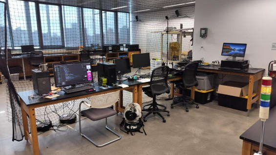
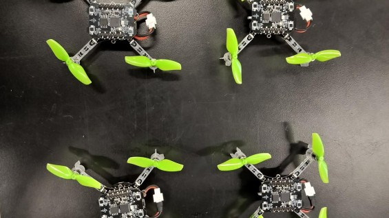
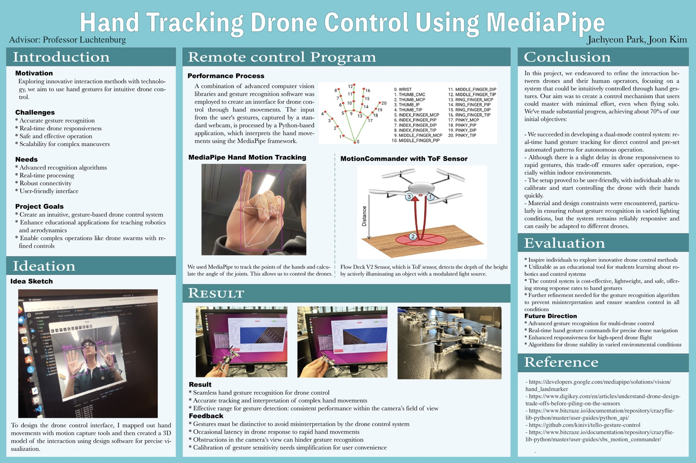
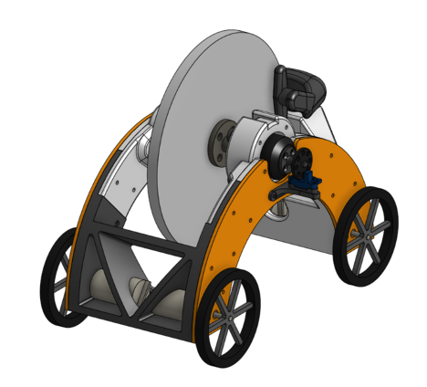

::: {.laboratory-container}

The Dynamics and Control Laboratory at The Cooper Union connects **mathematical modeling, feedback control, and physical experimentation**. Its experimental platforms enable the development and validation of control methods, the investigation of coordinated motion, and the physical visualization of dynamical systems.

{.laboratory-hero}

## Experimental platform

The laboratory operates an indoor quadrotor flight arena with a **six-camera Vicon motion capture system**, Lighthouse positioning infrastructure, and Crazyflie nano quadrotors. Real-time motion measurements and feedback controllers support autonomous flight, trajectory tracking, and coordinated multivehicle experiments.

## Selected projects

### Coordinated quadrotor flight

::: {.laboratory-project}
::: {.laboratory-project-text}
The motion-capture-based flight platform has been used to demonstrate hovering, trajectory tracking, and coordinated motion of multiple quadrotors. Experiments connect mathematical models and simulations with measured flight behavior, including circular trajectories and synchronized formations.

As part of his master's thesis work in 2019, Justin Rooney developed an interactive **magic wand** demonstration in which the wand's motion determines the hover set-point for a swarm of Crazyflie nano quadrotors. The vehicles respond collectively, producing coordinated motion reminiscent of migratory bird formations.

[Watch the drone tornado formation](https://youtu.be/FtZw3cjSUnk)  
[Watch the magic wand demonstration](https://youtu.be/yokDwyV2J5U)

*Related work: Justin Rooney, [master's thesis abstract (2020)](https://cooper.edu/sites/default/files/uploads/assets/engineering/files/2020/Spring%202020%20Abstracts/Justin%20Rooney.pdf).*
:::
::: {.laboratory-project-image}

:::
:::

### Embodied dynamical systems

::: {.laboratory-project}
::: {.laboratory-project-text}
Quadrotors serve as physical representations of dynamical systems governed by differential equations. Developed initially by Joon Kim and Jaehyeon Park through the [Vertically Integrated Projects (VIP)](https://cooper.edu/academics/vertically-integrated-projects) course, the hand-tracking interface uses computer vision and MediaPipe to control quadrotors. During summer research in 2024, Joon Kim extended the work with interactive demonstrations of mass–spring–damper systems, coupled oscillators, and pendulum motion. After release, a vehicle follows the motion prescribed by the mathematical model.

[Watch the hand-tracking demonstration](https://www.youtube.com/watch?v=eYEBc6EHLo8)

*Initial hand-tracking project: Joon Kim and Jaehyeon Park, VIP38XA — The Autonomy of “Smart” Cities. Summer 2024 research extensions and video demonstration: Joon Kim.*
:::
::: {.laboratory-project-image .laboratory-poster}

:::
:::

### Gyroscopic vehicle dynamics

::: {.laboratory-project}
::: {.laboratory-project-text}
A gyroscopically actuated vehicle project investigates three-dimensional rigid-body dynamics and the generation of control moments using rotating flywheels. The work combines reference-frame-based modeling, angular momentum analysis, numerical simulation, mechanical design, and prototype development.

The project illustrates how geometric descriptions of motion inform the design and analysis of unconventional vehicles.

*Related publication:* J. Chen et al., [“Part 1: Gyroscopic Control of Robotic Smart Vehicles Using SO(3)”](https://doi.org/10.1115/IMECE2023-113518), *Proceedings of the ASME 2023 International Mechanical Engineering Congress and Exposition*, IMECE2023-113518 (2024).
:::
::: {.laboratory-project-image}

:::
:::

:::
