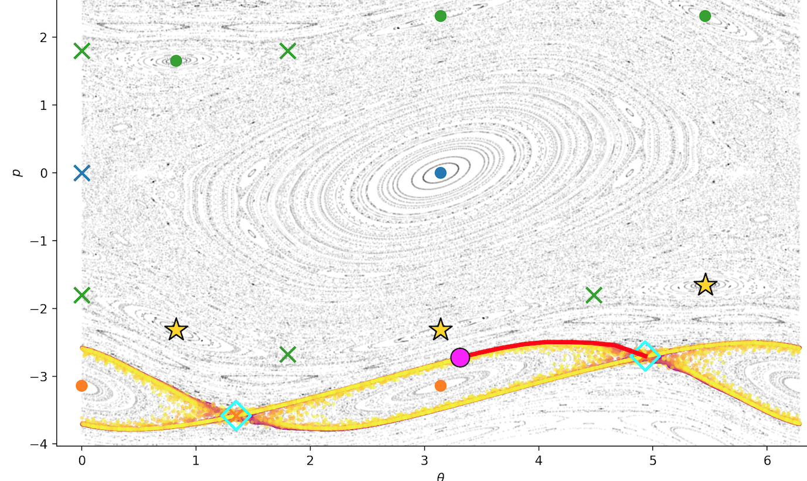
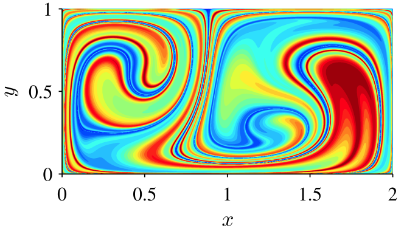
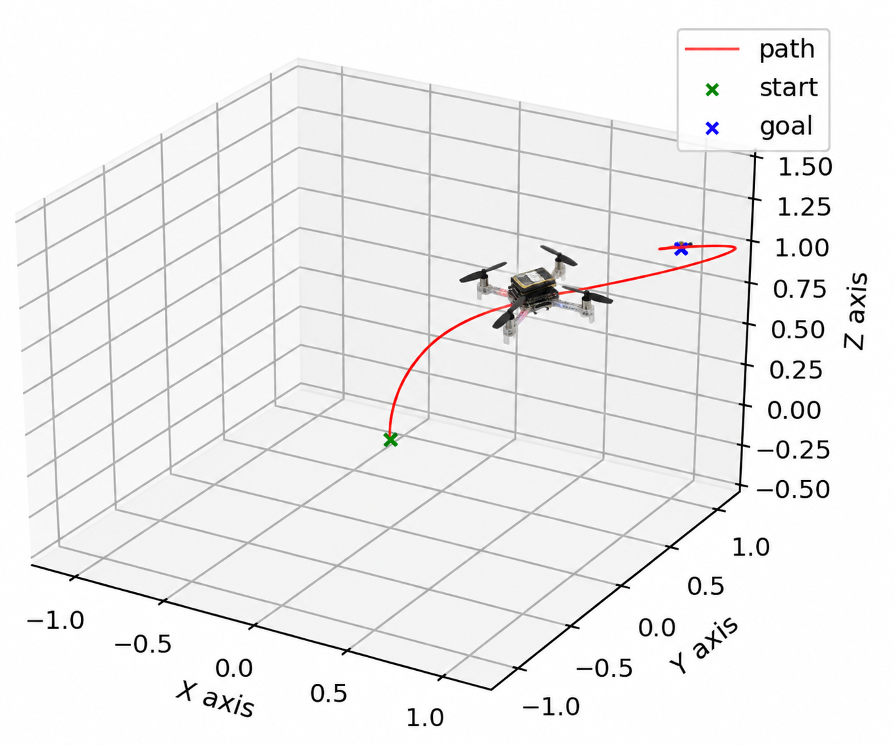

::: {.research-container}

My research concerns the mathematical modeling, analysis, and control
of dynamical systems. I am particularly interested in how mathematical
representations reveal the structures governing system behavior and
how these structures can be exploited for prediction and control.

Three closely connected themes run through my work.

::: {.research-section}

## Nonlinear dynamics and geometric methods

:::: {.research-row}

::: {.research-text}

Geometric structures, particularly invariant manifolds, provide insight
into the behavior of nonlinear dynamical systems.

My current research investigates how invariant structures can be used
to understand and control transport in nonlinear dynamical systems,
with applications in astrodynamics. In collaboration with Prof. Shane D.
Ross at Virginia Tech, this work includes hybrid control methods for
transfers between invariant structures and the classification of chaotic
trajectories in cislunar space.

Recent conference contributions include
[*Hybrid MPC–OGY Control for Transport Between Invariant Structures with
Application to Keplerian Maps*](https://s3.amazonaws.com/amz.xcdsystem.com/A464D031-C624-C138-7D0E208E29BC4EDD_abstract_File26718/PreprintPaperUpload_802_0710051123.pdf)
(D. M. Luchtenburg and S. D. Ross) and
[*Dynamical Classification of Chaotic Cislunar Trajectories via Resonance
Structure*](https://s3.amazonaws.com/amz.xcdsystem.com/A464D031-C624-C138-7D0E208E29BC4EDD_abstract_File26881/FinalPaperUpload_714_1002103829.pdf)
(A. M. Lutz, D. M. Luchtenburg, A. Rawat, and S. D. Ross).

:::

::: {.research-image}

:::

::::

:::

::: {.research-section}

## Modeling and prediction of dynamical systems

:::: {.research-row}

::: {.research-text}

Complex dynamical systems often admit lower-dimensional representations
that capture their essential behavior.

My contributions include reduced-order modeling of fluid flows,
proper orthogonal decomposition, dynamic mode decomposition,
and methods for long-time uncertainty propagation. Representative
publications include [*On dynamic mode decomposition: Theory and
applications*](https://doi.org/10.3934/jcd.2014.1.391) and
[*Long-time uncertainty propagation using generalized polynomial chaos
and flow map composition*](https://doi.org/10.1016/j.jcp.2014.06.029).

:::

::: {.research-image}

:::

::::

:::

::: {.research-section}

## Control of dynamical systems

:::: {.research-row}

::: {.research-text}

Mathematical modeling and dynamical systems theory provide the
foundation for understanding and controlling physical systems.

My work combines theoretical and computational methods with
experimental investigations, including ship stabilization,
robotic systems, autonomous vehicles, and student-led research
projects. An example is [*Seven Degrees-of-Freedom Model for the
Roll Stabilization of Unstable Ships*](https://doi.org/10.1115/1.4042950).

:::

::: {.research-image}

:::

::::

:::

---

Research at The Cooper Union involves undergraduate and master's
students in mathematical modeling, computation, simulation,
and experimental investigation.

[Selected publications](publications.qmd) ·
[Dynamics and Control Laboratory](laboratory.qmd)

:::
